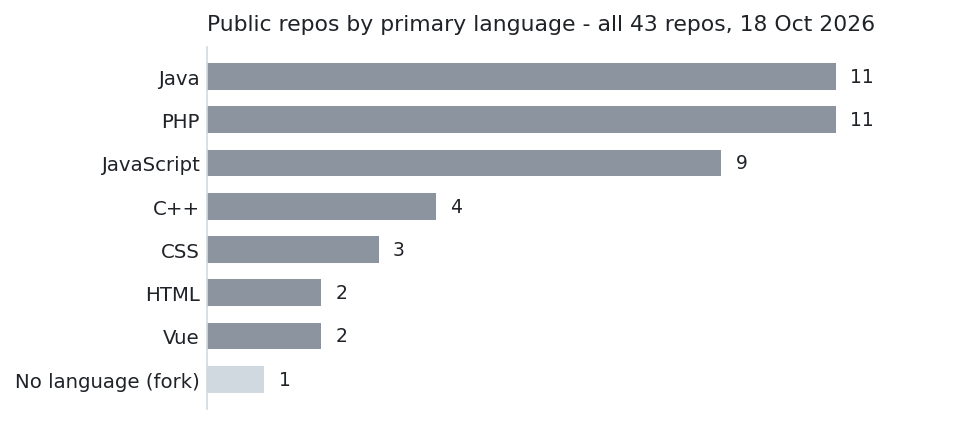

# Hi, I'm Egi

Full-stack developer in Indonesia. Java/Spring Boot on the backend, Nuxt on the frontend.

## Payment Gateway Starter

Checkout demo for Indonesian payments - virtual accounts, QRIS, e-wallets, retail outlets - via Xendit and Midtrans. Spring Boot API with verified, idempotent webhooks; live chat over SSE and RabbitMQ; FCM push notifications. Nuxt storefront + admin dashboard.

- API: github.com/Mauludinegi/payment-gateway-starter
- Web: github.com/Mauludinegi/payment-gateway-starter-web
- Live demo: payment-gateway-starter-web.vercel.app

## CosmoOrchestrator

Autonomous mission control for coding work: you describe a change in chat, a team of AI agents writes the spec, waits for your approval, codes in a sandbox, runs the tests, and opens a pull request. Nuxt + Nitro, E2B sandbox, intake via web, Telegram, WhatsApp, or Lark.

- Code: github.com/Mauludinegi/CosmoOrchestrator

## By the numbers

My public repos by primary language - all 43 of them, learning projects included. The PHP and C++ ones are older learning projects from 2022-2023; the Java and Nuxt work above is what I build now. One fork has no language detected. Counts from the GitHub API, 18 Oct 2026.

## Elsewhere

- Portfolio: solutionsgie.online
- LinkedIn: linkedin.com/in/mauludinegi
